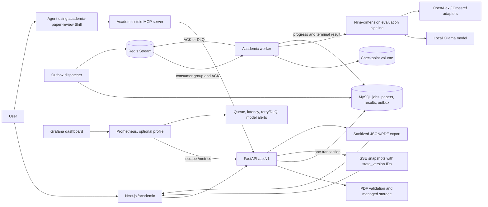
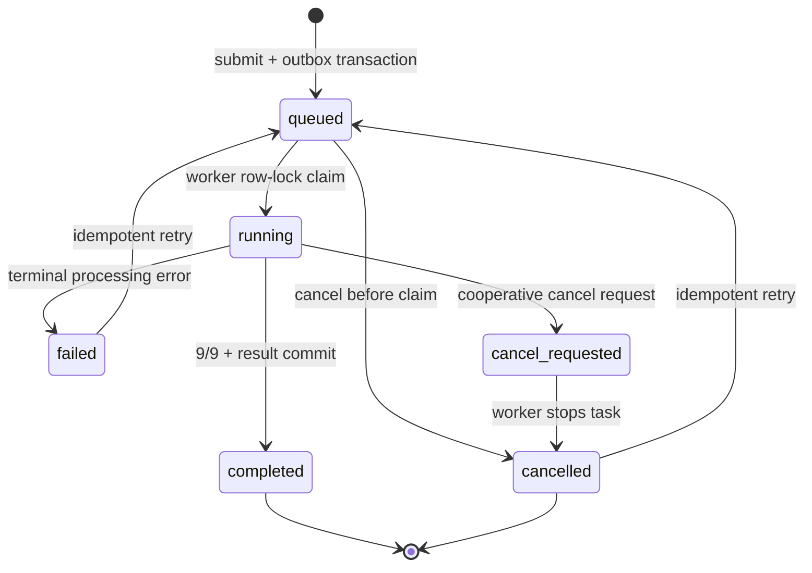
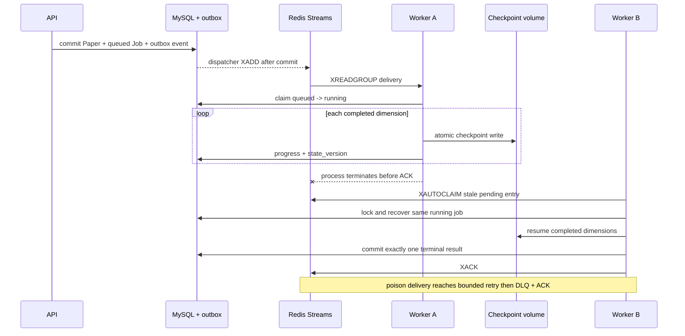
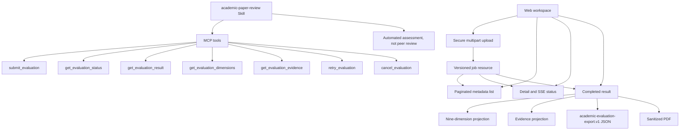

# Academic Paper Evaluation Architecture

Verified against the repository implementation on 2026-08-26. MySQL is
authoritative for lifecycle and final results, checkpoint files are
authoritative for partial-evaluation recovery, and Redis Streams is an
at-least-once delivery transport.

## Runtime architecture

The API and worker share the managed PDF/checkpoint volume. Public API, MCP and
export responses remove server paths, secrets, tracebacks and private fields.

## External scholarly evidence boundary

External retrieval is opt-in (`ACADEMIC_EXTERNAL_EVIDENCE_ENABLED=false` by
default). When enabled, the Worker searches through the existing OpenAlex-first,
Crossref-fallback policy using the submitted title or paper ID. It canonicalizes
and deduplicates results, removes the target paper, identifies the target year
when possible, and freezes the resulting metadata in the job checkpoint.

Only temporally eligible records are added to the `novelty` and
`citation_quality` prompts. They have separate `external_evidence_id` values and
can never satisfy or impersonate a PDF `evidence_chunk_id`. Later or undated
records are retained in the audit summary but excluded from prompts used to
judge prior work. Metadata and abstracts are untrusted quoted input, and the
prompt explicitly forbids following instructions inside them.

The search is discovery context, not an exhaustive literature review. Provider
failure, absent credentials, an unknown target year, or no result does not lower
a score: the structured `external_evidence.status` and warnings are persisted,
and internal-evidence scoring continues. API results, MCP evidence projection,
Web UI, JSON export, and PDF export expose the provenance and external IDs.

## Contradiction warning policy

Cross-paper contradiction results are separated from the paper score. A model
relation of `contradiction` or `partial_contradiction` becomes a review warning
only when its confidence is at least `0.95`; lower-confidence results do not
increase the unresolved-contradiction count. The threshold is frozen by
`data05b-qwen35-9b-chatgpt-dev-v1`, selected only on 24 ChatGPT-authored
development pairs. The calibration set includes no held-out LoRA or MBR data.
Its perfect warning-class development metrics must not be reported as held-out
accuracy; independent contradiction accuracy remains a separate evaluation.

## Persisted job lifecycle

`state_version` increases on persisted transitions and progress. SSE uses that
value as the stable event ID. Repeated retry/cancel calls return the accepted
state without publishing duplicate work.

## Checkpoint and delivery recovery

## Stable Web, API, MCP and Skill contracts

Canonical REST routes are under `/api/v1/academic/evaluations`. Legacy `/api`
routes remain compatible but are hidden from OpenAPI. Public responses declare
`academic-evaluation.v1`; export payloads declare
`academic-evaluation-export.v1`.

## Deployment and health boundary

- `academic-migrate` must exit successfully before API/worker startup.
- API liveness is process-only; readiness reports MySQL and Redis separately.
- Worker readiness reports MySQL, Redis and Ollama without killing liveness on a
  transient dependency outage.
- Compose publishes MySQL, Redis and API only on `127.0.0.1`.
- The optional `observability` profile publishes Prometheus and Grafana only on
  loopback; `/metrics` remains available even when the dashboard profile is off.
- `trusted_local` is the default development boundary; shared deployment uses
  constant-time `X-API-Key` verification.
